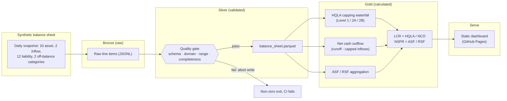

# Basel III Liquidity Reporting Pipeline (LCR and NSFR)

[](https://github.com/vabhishek8/basel-liquidity-reporting-pipeline/actions/workflows/pipeline.yml)

Computes the Liquidity Coverage Ratio (LCR) and Net Stable Funding Ratio (NSFR) for a synthetic Australian bank's daily balance sheet. The structure follows APRA Prudential Standard APS 210 and the Basel standards behind it, BCBS238 for LCR and BCBS295 for NSFR.

**[Live dashboard →](https://vabhishek8.github.io/basel-liquidity-reporting-pipeline/)**

**This is a portfolio project, not a regulatory tool.** The runoff, ASF and RSF factors are illustrative and simplified. A real APRA return carries counterparty, product and behavioural detail that isn't modelled here. No real balance-sheet data is used, and every figure is synthetic.

It's the third of three pipelines, and each one takes a different stance:

- [azure-medallion-weather-pipeline](https://github.com/vabhishek8/azure-medallion-weather-pipeline) is cost-optimised and serverless
- [aml-transaction-monitoring-pipeline](https://github.com/vabhishek8/aml-transaction-monitoring-pipeline) is private-endpoint compliance detection
- this one is a deterministic regulatory calculation with a hard deadline and a segregation-of-duties requirement

That last kind is closer to what a data engineer inside a bank's regulatory reporting or treasury team actually owns.

## Why I built it

AML detection is a statistical problem: did the rule catch the pattern? Liquidity reporting is a different problem. Did the calculation reproduce the exact number a regulator expects, from a formula that's published in full? Getting a deterministic calculation provably right, including the parts of the spec that are easy to misread, is a different skill from building a detector. It's also the more common day job. Most people in bank regulatory reporting are implementing formulas correctly against a deadline, not training models.

So I scoped it around three questions:

- Can the HQLA caps be implemented as specified, not as they first read? (See "What broke", below.)
- Does the pipeline treat a 30-day cash-flow shock (LCR) and a one-year structural funding shock (NSFR) differently, given the same event?
- Where does a maker-checker control belong in the architecture, rather than only in a policy document?

## How it's wired



## Is the calculation right? (measured)

Every ratio is checked against a value I calculated by hand, not eyeballed for plausibility. `tests/test_gold.py` has a small fixture with round numbers, the expected LCR and NSFR are worked out in the test's docstring, and the SQL has to match exactly.

| Check | Result |
|---|---|
| LCR formula matches hand calculation | Exact match |
| NSFR formula matches hand calculation | Exact match |
| Baseline day clears the 100% regulatory minimum on both ratios | Pass |
| Deposit-run scenario breaches LCR while NSFR stays healthy | Pass, by design (see below) |
| HQLA waterfall matches the correct sequential capping order, not a naive single cap | Pass, regression-guarded |

## What broke, and how it got caught

BCBS238 paragraph 51 sets the Level 2 asset cap as two nested rules. Level 2B can't exceed 15% of total HQLA, and Level 2 overall (2A plus 2B) can't exceed 40%. My first version applied only the 40% cap to the sum of 2A and 2B, because that's what the summary of the rule sounds like at a glance. On a portfolio heavy in Level 2B (the `l2b_heavy` scenario in `src/generate_balance_sheet.py`), that overstated total HQLA by about $65 million, roughly 8%, because the 15% sub-cap was never applied.

The fix caps Level 2B first, against Level 1, then adds Level 2A and applies the overall cap. `src/gold.py` still contains the naive version. Nothing uses it except `tests/test_gold.py::test_hqla_waterfall_not_naive_single_cap`, which needs something concrete to fail against.

### LCR and NSFR don't move together, on purpose

The `deposit_run` scenario cuts retail deposits by 20% and funds the withdrawal from cash and government securities. LCR, a 30-day stress measure, drops from a healthy ~195% to below 100%, which is a real breach. NSFR, a one-year structural measure, barely moves, because retail deposits still carry a favourable 90 to 95% Available Stable Funding factor whatever a short-term run assumes. NSFR measures something structurally different from LCR, not a slower version of it. `tests/test_gold.py::test_deposit_run_breaches_lcr_but_not_nsfr` checks both halves of that, not just the breach.

## The Azure version, and why it isn't running

`infra/main.bicep` makes different infrastructure calls from the other two projects, because this workload has a different shape: a scheduled batch of predictable size, a hard regulatory deadline, and a requirement that the process producing a number is separate from the person approving its submission.

| Decision | Reasoning |
|---|---|
| Synapse **Dedicated SQL Pool** (DW100c), not Serverless | This is the opposite call from weather-pipeline, deliberately. Serverless suits sporadic, unpredictable-volume queries; a fixed nightly batch against a hard submission deadline benefits from reserved, predictable throughput instead. The pool is paused outside the batch window, so it is not billed 24/7, the same cost discipline as the other two projects, applied to a different demand curve. |
| Geo-redundant storage (GRS), not LRS/ZRS | The one project in the portfolio using GRS. A missed submission because of a regional outage during the reporting window is itself a compliance failure, not just a data-durability question. |
| Separate `pending-submission` and `submitted` containers | Models a maker-checker control: the pipeline (the "maker") can only write to `pending-submission`; moving data to `submitted` requires a separate, independently-authorized action. This is a real control, not a nice-to-have, most banking regulatory frameworks require the preparer and the approver of a submission to be different people. |
| Dedicated `audit-log` container, 365-day Log Analytics retention in prod | This is an audit trail for who approved what and when, not operational telemetry. |
| Private endpoints for storage and the Synapse workspace | Standard hardening; lighter-touch than the AML project's VNet-everywhere posture because this is submission data, not raw PII/transaction data. |

Validated with `bicep build` (0 errors, 0 warnings, 20 resources). To deploy it yourself:

```bash
az deployment group create \
  --resource-group rg-basel-liquidity-dev \
  --template-file infra/main.bicep \
  --parameters envName=dev alertEmail=you@example.com
```

## Running it locally

```bash
python -m venv .venv && source .venv/bin/activate
pip install -r requirements.txt
python src/pipeline.py            # generate -> silver -> gold -> dashboard
PYTHONPATH=src pytest tests/ -v   # 23 tests: quality gate, generator invariants, golden calculations
open docs/index.html
```

## Repo layout

```
src/
  factors.py                  regulatory factor tables (HQLA levels, runoff, ASF/RSF)
  generate_balance_sheet.py   synthetic daily balance sheet, 3 engineered stress scenarios
  quality_checks.py           the silver quality gate
  transform.py                 bronze -> silver: parse, type, gate
  gold.py                       LCR/NSFR calculation engine, including the HQLA waterfall
  dashboard.py                   renders gold -> static Plotly HTML
  pipeline.py                     orchestrates all four stages
tests/                          23 pytest cases, including hand-verified golden calculations
infra/main.bicep                production Azure IaC: Dedicated SQL Pool, GRS storage, maker-checker containers
.github/workflows/               scheduled CI: test -> run -> commit refreshed gold data
```

## Stack

Python, pandas, DuckDB, Plotly, pytest and GitHub Actions. The Bicep covers a Synapse Dedicated SQL Pool, ADLS Gen2 with GRS, Data Factory, Key Vault RBAC and Log Analytics.

---

Built by [Abhishek Vadlamudi](https://abhishekvadlamudi.com), Senior Business Intelligence Engineer at Unisys in Sydney.
